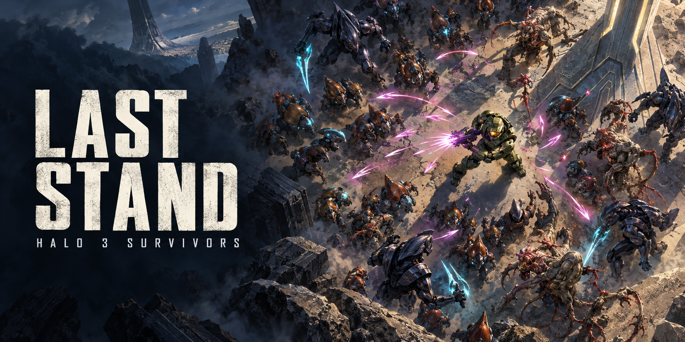

# Last Stand: Halo 3 Survivors

*Promotional concept art. [Artwork provenance](docs/images/README.md).*

**Installed gameplay baseline: v0.4.0 on Onyx-Linux** (2026-10-12).
This native Halo 3 mod combines a bird's-eye camera, automatic attacks, a
50-node skill tree and four outdoor stages on the Ark.

This is a playable prototype under active development. The repository contains
authored source, tests and release evidence; owned Halo assets, SDK binaries,
compiled maps and player saves remain local. See [ROADMAP.md](ROADMAP.md) for
unfinished work and [DEVELOPMENT.md](DEVELOPMENT.md) for checkout requirements.

Agents joining the project should start with the [full implementation plan](PLAN.md),
[task queue](TASKS.md) and [agent handoff guide](AGENTS.md). The task issues track
ownership, dependencies and acceptance evidence.

Want to help? Read the [contribution rules](CONTRIBUTING.md) and
[community rules](CODE_OF_CONDUCT.md), then
[report a bug or propose an improvement](https://github.com/lEWFkRAD/halo3-survivors/issues/new/choose).
Small fixes and clear playtest reports are welcome; native assets are not needed
for documentation or source-only contributions.

v0.4 adds Armory checkpoints with Continue/New Run, closer enemy spawns with
player-clearance checks, and batched level-ups. It also fixes victory cleanup:
Halo must process its queued actor deletion before enemies disappear.

The LS-04 source candidate adds a small camera switching margin to
reduce repeated pans near anchor boundaries, including during Continue repair.
It also gives cinematic status, help, points and rank notices dark text with a
pale shadow. Selected skill descriptions use a separate CHUD renderer and keep
their existing style. Native compile, four-stage view/movement checks and a
checkpoint process restart passed; see [the bounded test record](native-validation-ls04.json)
for evidence and limits. This candidate has not been promoted as a release.
The previous game and checkpoint are restored, and broader LS-04 work remains open.

The current LS-05 candidate adds seven native Armory reference pages: one per
weapon and one for support. They show all 50 nodes, branch choices, prerequisite
ranks and stage gates. All seven pages fit in the native SDK test; contrast on
bright terrain still needs polish. These are static maps; selected-skill details
and rotating rank/points notices continue to provide current purchase information.
Live graphical states across every node remain unfinished. See
[the bounded LS-05 record](native-validation-ls05.json), including native purchase,
category, Resume and checkpoint-restart checks. The installed release
remains v0.4.0; this candidate has no new cache or package promotion.

## Play

Open **Last Stand - Halo 3 Survivors** on Onyx-Linux. The shortcut uses the
owned Halo 3 standalone SDK engine and the new save-aware launcher. Allow
about a minute for the map to load. A saved run offers Continue, New Run and
Cancel; New Run archives the old checkpoint.

WASD moves; unlocked weapons fire automatically. The overhead camera follows
the player, with mouse look disabled.

| Armory action | Binding |
| --- | --- |
| Next skill | Space |
| Previous skill | Q |
| Buy one rank | Left mouse button |
| Next weapon/support category | Space + Q |
| Resume | 1 |
| Reopen Armory during combat | Space + Q |

Release buttons between actions. Enemies, automatic attacks and the survival
clock pause in the Armory; movement remains available and the player is
protected. Help, points and current rank rotate on screen. Each selected skill
shows its effects, price, prerequisite and stage requirement.

The LS-05 candidate uses these same controls. Its reference page follows the
selected weapon/support category within one second. Numbers beside prerequisite
names mean required ranks. Resuming stops page refresh immediately; the last
page expires within one second.

## Save your run

Opening the Armory and purchasing an upgrade request a native checkpoint.
Wait about three seconds before quitting. Continue restores the latest
Armory checkpoint, including the stage, clock, enemies, XP, points and upgrades.
Quitting during combat returns to the last Armory checkpoint.

Saves live in `saves/v04` under the Onyx workspace. The launcher checks their
hashes and exact engine/scenario/source/private-asset compatibility. Changed
builds may require a new run; earlier saves remain archived. QA profiles are
separate under `qa-saves` and never become the player's profile.

This resumes the same run. Permanent unlocks between separate runs remain
future work. These checkpoints are an SDK-launcher feature; retail MCC saving
has not been verified.

## Progression and encounters

The tree has seven nodes for each of six weapons and eight support nodes.
Each weapon includes unlock, damage and cadence upgrades, two exclusive
specializations, and a capstone for each specialization. Support upgrades
improve health, shields, recovery, range and XP. Kills award XP; all affordable
levels from a burst are awarded in one Armory visit. The point wallet caps at 50.

| Stage | Active duration | New weapons | New enemy families |
| --- | --- | --- | --- |
| Landing | 5 minutes | Needler, Assault Rifle | Grunts, Jackals, Brutes |
| Incursion | 5 minutes | Shotgun, Plasma Rifle | Captains, Snipers |
| Outbreak | 5 minutes | Rocket Launcher, Energy Sword | Flood combat, infection, carriers |
| Last Stand | 5 minutes | Branch capstones | Hunters, Chieftain |

Needler starts unlocked; other weapons require a purchase. All ranks, unlocked
weapons, XP and points carry between stages. Earlier enemy families continue
appearing later. Most spawn points are now 5.5–8 map units from the arena center;
snipers and heavy enemies retain more distance. A cohort waits if any spawn
point is within two units of the player, while other eligible groups continue.
The global limit remains 36 enemies. Leaving the arena returns you to its center.

Victory clears hostiles and leaves a protected result screen with gameplay
stopped. Close and relaunch, then choose New Run to start again.

Attacks currently apply immediate automatic damage with distinct effects,
range, cadence and target counts. Travelling projectiles, physical XP pickups,
vehicles, live graphical tree states and exhaustive full-run balancing remain future work.
The prototype is solo. Retail MCC mod-menu loading remains unverified pending
owner Xbox/Microsoft sign-in and testing.

## Validation and release

The v0.4 release passed 109 deterministic tests. Native checks cover eight menu assertions,
22 stage/roster/cap assertions, all six weapons, six spawn-clearance assertions,
three batched-level assertions, and a 10-second clock test. A complete process
restart restored stage 2, 430 seconds, 81.25 XP, 7 points, Assault Rifle unlock
rank 1, Needler damage rank 2, 123 shots and 17 hostiles; the camera, paused
Armory and real resume key worked.
The final victory test began with enemies and confirmed zero actors after
cleanup and a frozen result after six seconds.

Final Sapien readback: 400 scripts, 175 globals, 40,242 syntax datums, 121 titles.
Most combat/menu tests preceded the one-line final victory cleanup fix;
`victory-cleanup-v04.diff` and the validation record identify that scope.
Final compile, restart/camera/input and victory were verified afterward.

- [Native validation](native-validation-v04.json)
- [Build receipt](cache-build-receipt-v04.json)
- [Package promotion](promotion-v04.json)
- [Installed build](build-result-v04.json)
- [Launcher installation](launcher-install-v04.json)
- [v0.4 details](README-v0.4.md)

The map is 704,286,720 bytes, SHA-256
`58b6455b3928874d714cae00e28bb40ffc177e8e4d759376ea44c7c954b21ec3`.
The previous package is preserved in
`backups/package-before-v04-20261012T183644Z-80cf4639`; the prior launcher is in
`backups/launcher-before-v04-69157a49ac`. Package GUIDs and registration remain.
The build receipt records the native tool's exit separately from Snap cleanup.

## Source

Onyx workspace: `/home/jeffrey-watts/Documents/Games/Halo3Survivors`.
The local MCC package is `mods/LastStand`. The private scenario and HSC live
under the owned Steam Snap H3EK installation.

Run `python -B -m unittest discover -s tests` locally. Native tag geometry tests
require the external binding/assets described in [DEVELOPMENT.md](DEVELOPMENT.md).
The current suite passes 217 tests in the owner workspace. Source-only checkouts
skip the module containing five native geometry tests when its external inputs
are unavailable. The v0.4 release evidence above retains its historical test counts.
`prepare_progression.py`
authors the tags/HSC after a prerequisite guard. First run
`python -B prepare_progression.py --check` for a read-only input report.
`python -B preflight.py --stage source` checks a checkout without game assets;
local configuration and read-only remote checks are described in
[DEVELOPMENT.md](DEVELOPMENT.md). The remaining fresh-kit rebuild gaps are
tracked in [BOOTSTRAP.md](BOOTSTRAP.md).
`onyx_progression.py stage` / `compile` use Sapien and still require manual
path adaptation and the native operator slot.
`promote_v03.py` retains its historical filename but now targets v0.4.0 and
requires matching native evidence and a fresh successful cache receipt.
`launch_v04.py` is installed as the Onyx workspace's `launch.py`.

`bundle_source.py` produces `dist/last-stand-v0.4-source.zip` from an explicit
allowlist with per-file hashes. It contains authored source, tests, contracts,
release evidence and documentation. It excludes owned game tags, native
caches, screenshots and videos, and is not a playable map. No public Workshop
publication is claimed. The v0.3 source ZIP preserves the previous release.
